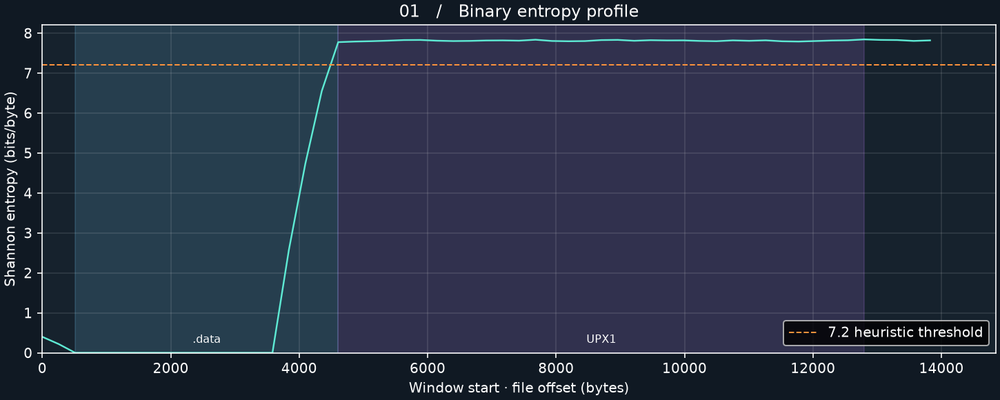
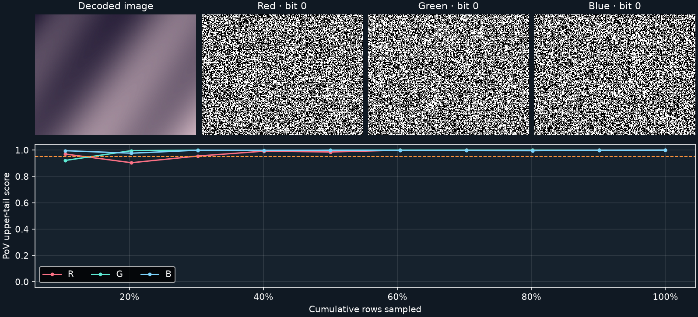

# Shannon Forensics

  

Profile an executable by file offset, or inspect an image for intensity-pair equalization. Each result ties the observations to a SHA-256 digest of the bytes analyzed. Samples are never executed, unpacked, or altered. The engine does not recover hidden messages.

```text
Read-only snapshot + SHA-256
  |
  +-- PE / ELF / raw --> byte histograms --> section & window entropy
  |                       + Pearson / π      + imports & overlay
  |
  +-- PNG / BMP / TIFF -> decoded RGB ----> LSB planes & row-band entropy
                          + EOF / metadata   + progressive PoV tests
                                               |
                     observations + heuristic verdict
                            |          |           |
                       Rich tables   PNG/HTML   JSON/Markdown
```

## Run a case

```sh
python -m venv .venv
. .venv/bin/activate          # Windows: .venv\Scripts\activate
python -m pip install -e '.[test]'
python scripts/generate_test_artifacts.py samples
mkdir reports
shannon-forensics analyze-bin -f samples/packed-simulation.exe --window 1024 --step 256 \
  --plot --html reports/binary.html --json reports/binary.json
shannon-forensics analyze-img -f samples/stego-simulation.png --plot \
  --html reports/image.html --markdown reports/image.md
shannon-forensics batch -d samples --json reports/summary.json
pytest -q
```

`python main.py` is equivalent to `shannon-forensics`. `--plot` writes `entropy_plot.png` or `steg_plot.png` **in the current directory**. `--html` includes the chart even without `--plot`; no CDN or sidecar files are needed. Output paths must be new files with existing parent directories: no silent overwrites of evidence or reports. Use a fresh case directory for repeat runs.

### Reading a result

| Verdict | What triggered it |
| --- | --- |
| `CLEAN` | No configured rule fired. Not a safety certificate. |
| `SUSPICIOUS` | For example, low-entropy padding, a high-entropy window or overlay, imports limited to resolver APIs, a malformed executable header, trailing image bytes, or metadata over 64 KiB. |
| `PACKED / ENCRYPTED` | A packer-associated section name, code section above 7.2 bits/byte, or raw blob above that threshold. A pattern label, **not** packer attribution or evidence of malware. |
| `STEGO DETECTED` | Sustained PoV equalization across at least two decoded color channels. A statistical lead, **not** proof of a payload. |

**Binary.** Windows and entropy-based flags need at least 256 sampled bytes to trigger a finding (statistics are still computed below this size). Low-entropy flags use <1 bit/byte. PE sections use `PointerToRawData` and `SizeOfRawData`, not virtual addresses. The PE overlay starts beyond headers, section extents and any declared certificate table; an ELF overlay starts beyond header tables, file-backed sections and segment extents. BSS has no disk entropy. Unmapped data can be legitimate, including debug data and installer resources. Section names can be arbitrary. Imports cover the ordinary PE import directory only, not delayed or dynamically obtained symbols. `MZ` or ELF magic with unreadable structure yields a warning and raw measurements, not a verified parse.

**Images.** Row-prefix PoV scores are displayed separately for R/G/B; JSON includes counts of eligible pairs, degrees of freedom, statistic, conditional p-value and local parity entropy. `null` means unavailable rather than zero. PNG chunks are traversed by length to a checksummed IEND; BMP uses the declared file size. TIFF lacks a universal EOF marker (`trailing_bytes: null`); only its first frame is studied. PNG animation is likewise not analyzed across frames. Only decoded 8-bit RGB intensities are tested; alpha is ignored. High-depth/lossy or unsupported TIFF inputs are rejected. Palette and grayscale images receive diagnostics but no color-based stego verdict. Metadata size counts decoded string/byte fields (including profiles/comments/EXIF where exposed by Pillow), not every on-disk metadata structure.

**Batch.** Recursively scans regular files, skipping symlinks. Image magic or a supported image extension selects image mode; other files go through binary mode. JSON contains one compact finding summary or error per file; single-file JSON preserves full profiles. Use an output directory outside the evidence tree. Exit `0` means completed (including positive findings); `1` means a processing/output failure, including any batch item error; `2` is argparse usage error.

## Synthetic casebook

The generator uses a fixed RNG seed. `benign.bin` contains repeated inventory text. `packed-simulation.exe` is an inert PE32 layout with zero-filled data, a random `UPX1` region, and a random trailer, **not a working packer**. `cover.png` and `stego-simulation.png` share upper-bit content; the latter simulates full-rate LSB replacement with fair bits, not a concealed message. Tests also cover partial-prefix replacement and spurious format signatures.





## Running on untrusted evidence

Work on immutable copies. Parsers and image decoders process untrusted bytes; static analysis is not a sandbox. The CLI caps input at 64 MiB/file and 16 million decoded pixels; binary profiles are limited to 250,000 windows and 512 MiB of aggregate window work. Increase `--step` to fit large files. Use OS-level memory, CPU/time and directory-size limits for hostile or bulk input. Pin reviewed dependency versions for a forensic deployment and record them alongside case outputs (`python -m pip freeze`).

```sh
docker build -t shannon-forensics .
# Mount only case evidence read-only. Use a writable, separate reports directory.
docker run --rm --network none --read-only --tmpfs /tmp --memory 1g --cpus 1 \
  --user "$(id -u):$(id -g)" -v "$PWD/samples:/evidence:ro" -v "$PWD/reports:/reports" \
  shannon-forensics analyze-img -f /evidence/cover.png --html /reports/cover.html
```

See [THEORY.md](THEORY.md) for the equations, sampling assumptions, exact classification rule for images, and why none of these measurements distinguishes encryption from compression with certainty.
